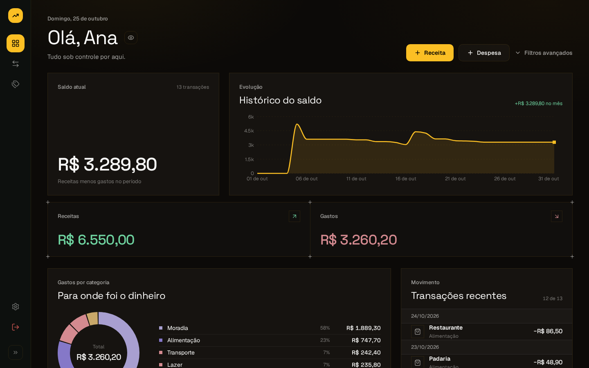
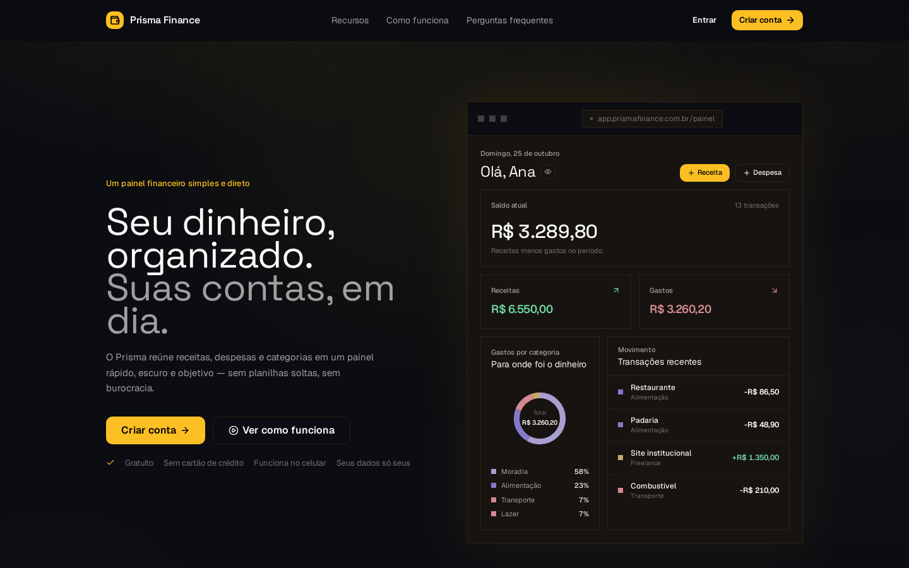
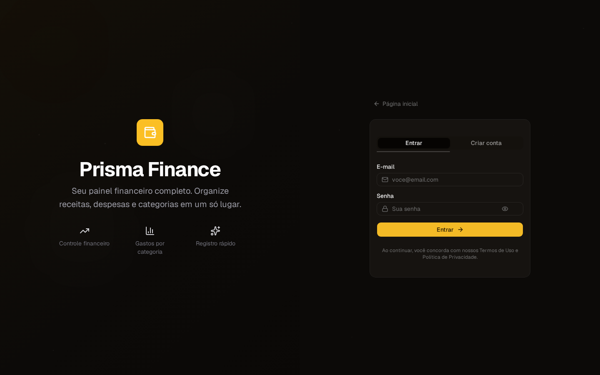
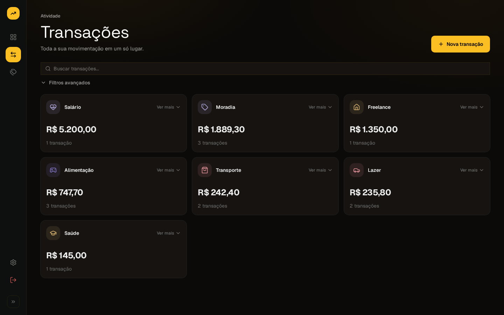
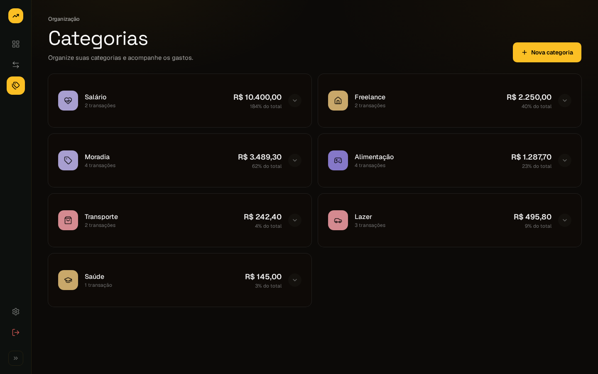
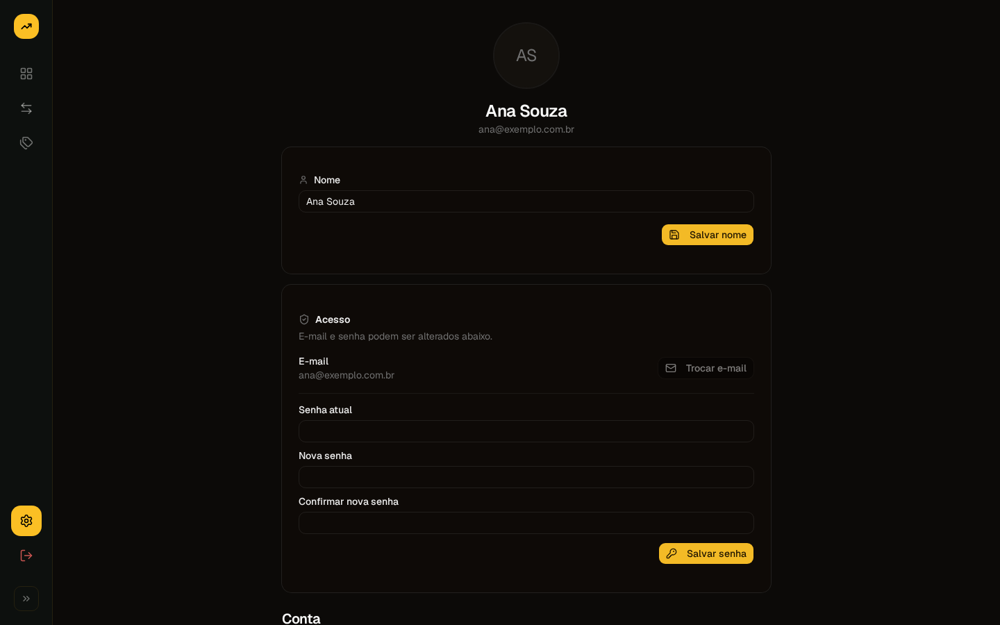
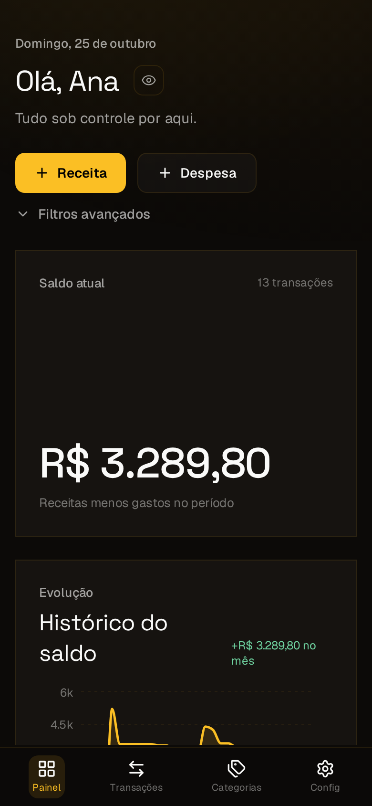
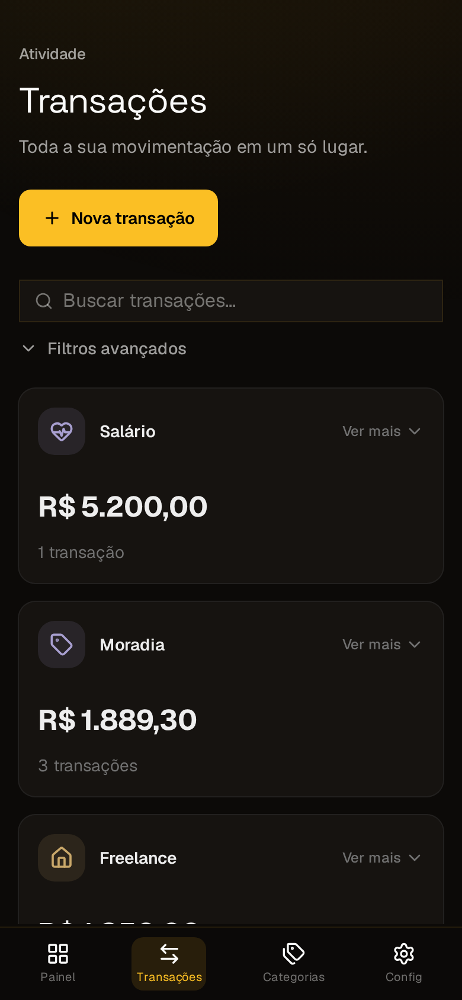

# Prisma Finance

> Seu dinheiro, organizado. Registre receitas e despesas em segundos e veja, num painel só, para onde o dinheiro está indo.

### [Acessar o Prisma Finance →](https://prismafinance.up.railway.app/)

Gratuito, sem cartão de crédito e funciona no computador e no celular.

**Sumário:** [Por que existe](#por-que-existe) · [Como funciona](#como-funciona) · [Telas](#telas) · [Seus dados](#seus-dados) · [O que vem por aí](#o-que-vem-por-aí) · [Sobre este repositório](#sobre-este-repositório)

---

## Por que existe

Quase todo mundo já tentou controlar os gastos numa planilha e desistiu depois de duas semanas. Dá trabalho abrir, preencher, somar e, no fim do mês, a pergunta continua sem resposta: **para onde foi o dinheiro?**

O Prisma Finance foi feito para responder essa pergunta com o menor esforço possível:

- **Registrar leva segundos.** Valor, descrição, data e categoria. Pronto.
- **O painel faz as contas.** Saldo, total de entradas e saídas e gastos por categoria aparecem sozinhos.
- **Sem conectar banco.** Você registra o que quiser, do jeito que quiser. Ninguém além de você vê os seus números.
- **Gratuito de verdade.** Não tem plano pago, cartão de crédito ou letra miúda.

---

## Como funciona

1. **Crie sua conta** com nome, e-mail e senha. Leva menos de um minuto.
2. **Crie suas categorias**, como Mercado, Transporte ou Salário, cada uma com sua cor e seu símbolo.
3. **Registre receitas e despesas** conforme elas acontecem.
4. **Acompanhe no painel** o saldo do mês, a evolução dia a dia e para onde foi cada real.

---

## Telas

> Todas as capturas usam dados de exemplo.

### Página inicial
A primeira coisa que a pessoa vê: o que o Prisma faz, uma prévia do painel e o caminho para criar a conta.

### Entrar
Login com e-mail e senha, no mesmo visual escuro do resto do sistema.

### Painel
O coração do sistema. Num só lugar:
- **Saldo atual**: receitas menos gastos no período.
- **Histórico do saldo**: como o dinheiro se moveu ao longo do mês.
- **Receitas e gastos**: os dois totais lado a lado.
- **Para onde foi o dinheiro**: gráfico com a parte de cada categoria nos gastos.
- **Transações recentes**: os últimos lançamentos, por data.

O botão de olho, ao lado da saudação, esconde todos os valores. É útil para abrir o app em público.

### Transações
Todas as entradas e saídas, agrupadas por categoria, com busca e filtros. Qualquer lançamento pode ser corrigido ou excluído a qualquer momento.

### Categorias
Cada categoria tem nome, cor e símbolo próprios, e mostra o total acumulado, a fatia que representa nos gastos e as transações que fazem parte dela. Dá para criar, renomear e excluir categorias quando quiser.

### Configurações
Troca de nome, e-mail e senha, exportação dos próprios dados e saída da conta.

### No celular
O sistema se adapta à tela do celular, com navegação na parte de baixo, e pode ser instalado na tela inicial como um aplicativo.

  
  &nbsp;&nbsp;
  

---

## Seus dados

O Prisma lida com dinheiro, então cuidar dos dados vem antes de qualquer outra coisa:

- **Cada conta só vê os próprios dados.** Ninguém acessa as transações ou categorias de outra pessoa.
- **Senha protegida.** A senha nunca é guardada como foi digitada.
- **Conexão segura** entre o seu aparelho e o sistema.
- **Proteção contra tentativas repetidas** de adivinhar senhas no login e no cadastro.
- **Nada é vendido nem compartilhado** com terceiros.

---

## O que vem por aí

O Prisma já tem os primeiros usuários, e é o feedback deles que decide o que vem a seguir. Na fila:

- [ ] Confirmação de e-mail no cadastro, com um código de 6 dígitos
- [ ] Recuperação de senha por e-mail
- [ ] Mensagem de boas-vindas só no primeiro acesso
- [ ] Mais filtros e comparação entre meses

---

## Sobre este repositório

O Prisma Finance está no ar com dados de pessoas reais, por isso **o código-fonte fica num repositório privado**. Este repositório é a vitrine do projeto: o propósito, as telas e o que vem pela frente.

**Quer testar?** [Crie sua conta no Prisma Finance](https://prismafinance.up.railway.app/).

**Encontrou um problema ou tem uma sugestão?** Abra uma [issue](../../issues) aqui. Se for algo de segurança, não publique os detalhes: fale comigo pelo [meu perfil no GitHub](https://github.com/Kaueroch).

---

*Feito por [Kauê Alcantara Rocha](https://github.com/Kaueroch) · 2026*
